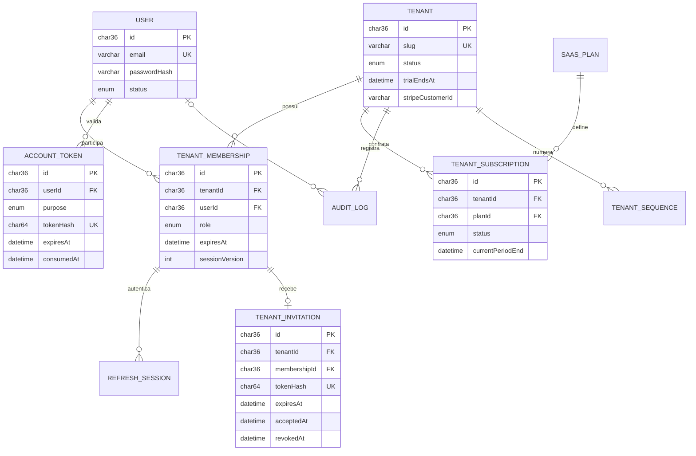
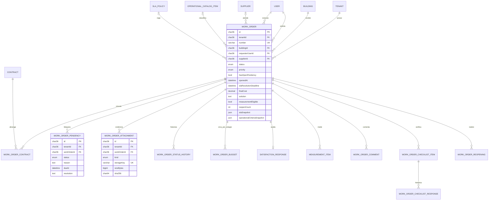
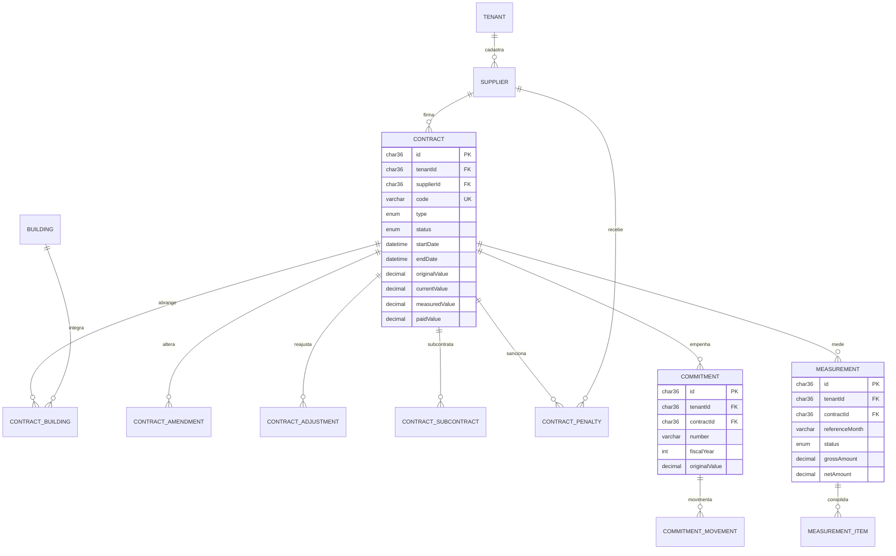
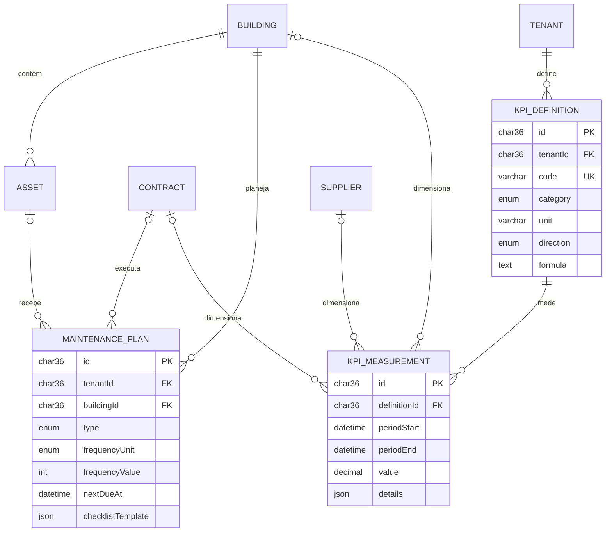

# Modelo e dicionário de dados

## Gestão Contratual V3 — planilhas e memória por movimentos

O movimento `metadata-enrichment` conserva correções cadastrais de descrição/unidade com valores anteriores, posteriores, hash da fotografia, referência SINAPI, identificador da definição e proveniência por campo. Não realiza conversão de unidade nem muda preços, quantidades, códigos, descontos, medições, pagamentos ou linha de base. A referência é lida somente para suprir campos ausentes na fotografia e no catálogo privado. A prévia confere todos os itens da origem e exige ausência de pendências antes da confirmação. Utiliza `GcAction` existente; não requer DDL nem regravação de `GcSource`/`GcContract.baseline`.

O replay histórico mantém a fotografia financeira original. A apresentação das planilhas antigas pode aplicar a anotação cadastral mais recente, expondo `descriptionAtSnapshot`, `unitAtSnapshot` e `metadataProvenance` com ação e versão responsáveis. Essa anotação não altera a memória original do boletim ou do aditivo. A reutilização idempotente de uma captura da mesma origem/cenário compara integralmente seus parâmetros, exceto esses descritores cadastrais derivados; todos os parâmetros financeiros continuam sendo comparados.

Implementação destinada exclusivamente ao desenvolvimento. A migration explícita `004_contract_scenarios.sql` acrescenta `GcContract.scenario_key` com padrão `LEGACY` e amplia o índice único para `(tenant_id,owner_id,source_id,regime,demo,scenario_key)`. Não altera identidade, valores ou movimentos dos contratos existentes. O rollback desabilita o módulo e preserva coluna/índice; não se deve recriar o índice anterior após haver cenários alternativos nem excluir contratos para ajustá-lo.

A V3 mantém a fotografia comprimida em `GcSource`, a linha de base em `GcContract.baseline` e movimentos imutáveis em `GcAction`. A prévia nunca cria linha, reserva ou snapshot persistido. Reajuste em lote guarda um único movimento `price-batch`, com regras derivadas identificadas por `actionId-índice`; o lote inteiro é validado antes de qualquer gravação.

A captura conserva `number`, `groupId`, `groupName`, `groupPath`, `sourceOrder`, datas e grupos da EAP, além de `sourceUnitPrice`/`sourceTotal`. Serviços novos mantêm uma cópia imutável da inclusão. A memória de medição registra quantidade contratada, anterior, do período e acumulada no instante da aprovação; sua sequência é de aprovação, não de criação de rascunhos.

Planilhas históricas completas são reconstruídas pelo replay até a aprovação do boletim ou até o aditivo selecionado. Não duplicam centenas de linhas por consulta e não aplicam reajustes posteriores a documentos antigos. Incluem linhas sem movimentação, com os preços vigentes naquele corte. Pagamentos continuam sendo movimentos próprios posteriores.

`baseline.demoScenario=BUILDING_ANALYTICAL_V3` identifica uma captura demonstrativa independente, com proposta fictícia heterogênea e paradigma explícito. O cenário reutiliza a fotografia da fonte e não substitui demonstrações V1/V2 nem orçamentos originais. Mesmo cenário, origem, proprietário e regime retornam a captura existente; parâmetros diferentes são rejeitados. O planejamento financeiro demonstrativo pode ser proporcionalmente normalizado à proposta, com memória da escala e aviso explícito, preservando a fonte integral.

## Gestão Contratual v2 — desenvolvimento, 14/11/2026

Banco MySQL independente `GESTAO_DATABASE_URL`, sem fallback nem migrations nos bancos OrçaPro/Infra. As migrations explícitas `apps/api/contract-migrations/001_contract_management.sql`, `002_contract_operations.sql` e `003_contract_billing.sql` são aplicadas por operador, com checksum em `GcMigration`; não há DDL no startup.

`GcSource` preserva uma fotografia gzip, deduplicada por tenant/proprietário/produto/projeto/versão/hash; `GcContract` guarda uma base imutável, regime, valor original DECIMAL e versão; `GcAction` registra movimentos incrementais, ator, versão única e UUID/hash idempotente. O motor reconstrói estado e preços históricos por replay; não duplica a planilha a cada ação nem copia os catálogos SINAPI/SICRO. A integração captura exclusivamente orçamentos autorizados e não escreve nas origens. Contratos reais exigem paradigma informado; exemplos usam paradigma didático identificado.

`GcMember` concede MANAGER/FISCAL/READER e revoga com REVOKED, preservando histórico. Proprietário permanece gestor; não há acesso global automático. Consultas e mutações conferem tenant do token, membro/proprietário e licença do proprietário daquele contrato. Contratos reais exigem aprovador diferente do autor do boletim. `GcAdministrativeAudit` registra alterações de papéis, anexos e importações; ações financeiras mantêm sua própria versão/auditoria transacional.

`GcImport` mantém hash original, localização privada, prévia gzip, mapeamento/hash, validade de 24h e IDs de contrato/ação confirmados. Importação de medição cria rascunho, vincula arquivo e confirma recibo atomicamente; não importa preços da planilha, não aprova nem paga. `GcAttachment` contém somente metadados. Bytes ficam sob `GESTAO_STORAGE_ROOT`, absoluto e fora de public/public_html/www, em arquivos privados nomeados por hash. `GcBlob` contabiliza bytes únicos por escopo tenant/usuário; `GcStorageAccount` serializa a verificação da quota (100MB por tenant por padrão, `GESTAO_STORAGE_LIMIT_BYTES`). Não há exclusão automática de documentos ou histórico; prévias expiram para uso, mas a retenção privada continua contabilizada até manutenção explícita.

Dinheiro relacional usa DECIMAL; valores em payloads são strings decimais. Índices, diferenças retroativas, reservas compensatórias, retenções e restituições são movimentos separados. Pagamentos são registros do usuário, não transferências bancárias. A infraestrutura de assinatura usa tabelas próprias GcBilling*, exclusivamente Stripe de teste neste ambiente, sem plano comercial ativo nesta entrega. Rollback desabilita GESTAO_ENABLED e restaura o artefato anterior, preservando banco e arquivos privados; não reverte migrations com exclusão de dados. A estimativa MySQL de dados/índices pode diferir da ocupação física exibida pelo hPanel.

### Memórias contratuais e licenciamento da v2

| Registro | Conteúdo e invariantes |
|---|---|
| `GcContract.baseline` | Itens/eventos originais, regime, paradigma, data-base e planejamento adotado. Dois cenários didáticos do edifício utilizam a fonte de 283 itens sem modificar o projeto de origem. |
| `GcAction` | Aditivos, regras de preço, medições, diferenças, pagamentos, restituições, conciliações e avanço físico. Ator e versão permanecem auditáveis; linhas novas de aditivo preservam cópia de seus valores originais, sem referência mutável ao item corrente. |
| `GcImport` | Mapeamento de orçamento ou medição, preços paradigma informados por linha, correspondências, exclusões justificadas e hash de confirmação. `confirmed_action_id` impede duplicar a medição importada; anexação/recibo/ação são confirmados juntos. |
| `GcBillingAccount` | Chave `(tenant_id, owner_id)`, customer/subscription próprios e únicos, status, período, cancelamento programado, bloqueio de risco e recibo de Checkout com requestId/expiração. Não altera assinaturas do OrçaPro/Infra. |
| `GcBillingEvent` | ID Stripe único, tenant/proprietário, tipo, hash do payload, instante do evento e processamento. Deduplicação de webhook sem armazenar credenciais ou exigir payload completo no histórico. |

`currentValue` é o escopo em preços-base; `currentPricedValue` e `priceAdjustmentValue` valorizam a planilha na `priceReferenceDate` declarada. Não são saldos automaticamente pagáveis. Medições preservam preços aplicados na execução e diferenças retroativas aparecem em boletins próprios. `effectiveDeduction`/`effectiveNet` incorporam conciliações posteriores sem apagar dedução/líquido originais. Reservas, retenções, restituições e conciliação pendente são grandezas distintas.

Papéis `MANAGER`/`FISCAL`/`READER` dependem do contrato e da organização autenticada; `REVOKED` conserva histórico sem autorizar acesso. A isenção do administrador é de assinatura, não de isolamento. Membro compartilhado usa a licença do proprietário daquele contrato, enquanto criação de contrato exige licença própria. A relação é verificada em leitura e mutação, não apenas no menu.

Stripe está configurado exclusivamente em TEST com produto/preço fictício de R$ 1,00/mês. Esse valor não define plano comercial nem cobrança real. Retorno de Checkout não muda entitlement por si só: a liberação exige evento verificado e situação/período válidos da assinatura. Configuração, conta e eventos ficam separados das assinaturas existentes dos demais produtos.

A implementação v2 e suas migrations são documentadas em [ADR 0010](adr/0010-gestao-contratual-banco-independente.md). Verificações locais não substituem medição remota atual de espaço nem validação operacional após a ativação.

## Auditoria Infraestrutura detalhada — 27/10/2026

`InfraAudit` mantém colunas e todos os eventos existentes. A migration independente `002_detailed_audit.sql` acrescenta apenas índices `(created_at,id)` e `(user_id,created_at,id)`. Os novos eventos de acesso/navegação usam payload limitado e sanitizado; não gravam documentos de projetos nem credenciais. Consulta global somente por administrador Infraestrutura; navegação continua validando tenant e proprietário. [Operação, privacidade e rollback](infraestrutura-audit.md).

## Preços de insumos no orçamento — 27/10/2026

Campos JSON aditivos em `OrcaproProject.data` e `InfraProject.data`: `inputPriceOverrides` (chave código/UF/mês/regime, preço em centavos, CHP/CHI quando aplicável, fonte e data) e `inputPriceHistory` (alterações confirmadas). São dados privados do projeto, presentes nas versões e exportações, sem atualizar catálogos referenciais ou biblioteca privada. Não exige migration nem modifica usuários/orçamentos existentes. [Especificação](project-input-prices.md).

## Auditoria OrçaPro — 16/10/2026

`OrcaproAudit` preserva os eventos de negócio existentes e recebe eventos de acesso e navegação. Índices aditivos `(createdAt,id)` e `(actorUserId,createdAt)` atendem paginação estável e filtros. Não há exclusão, substituição ou reconstrução retroativa de eventos. Identidades e nomes de orçamentos são resolvidos na consulta administrativa global, com seleção explícita de campos; projetos continuam privados nos endpoints operacionais. Credenciais e documentos completos nunca entram no novo registro de acesso. Rollback: voltar código mantendo tabela, eventos e índices; opcionalmente remover somente os dois índices da migration 20261016140000.

## 1. Convenções

- Chaves primárias: UUID armazenado como `CHAR(36)` no início.
- Datas: UTC no banco; apresentação no fuso do tenant.
- Valores: `DECIMAL`, nunca ponto flutuante.
- Exclusão lógica: `deletedAt` nas entidades principais.
- Segregação: entidades de negócio contêm `tenantId` quando precisam de consulta ou validação direta por tenant.
- Nomes no banco permanecem em inglês para consistência técnica; interface e documentação funcional ficam em português.

## 2. Núcleo SaaS

## 3. Núcleo operacional da OS

### 3.1 Extensões operacionais da v0.7

- `OperationalCatalogItem` mantém categorias, especialidades, ambientes e causas por tenant. Categorias carregam prioridade e critérios de evidência, checklist, custo e aceite.
- `ChecklistTemplateItem` define o modelo ativo; `WorkOrderChecklistItem` é o snapshot da OS e `WorkOrderChecklistResponse` é append-only, preservando todas as respostas.
- `SlaCalendar`, `SlaHoliday` e `SlaPolicy` modelam tempo corrido/útil, feriados, múltiplos turnos e precedência tenant/contrato/categoria.
- A OS armazena `slaSnapshot` e `operationalCriteriaSnapshot`, evitando que alterações futuras de configuração mudem seu histórico.
- `WorkOrderComment` e `WorkOrderCommentMention` registram comunicação cronológica sem rotas de edição/exclusão.
- `WorkOrderReopening` preserva motivo, estado, aceite, custos, avaliação e o ciclo completo de SLA do fechamento anterior, além do indicador de reabertura em 30 dias. A avaliação corrente é removida atomicamente na reabertura para que o novo ciclo não reutilize a nota anterior.
- `NotificationPreference`, `Notification` e `NotificationOutbox` implementam preferências, caixa interna e entrega transacional com retry.
- `GeocodingCache` isola por tenant as consultas normalizadas, candidatos e expiração do cache.

## 4. Contratos e financeiro

## 5. Manutenção planejada e indicadores

## 6. Dicionário das entidades centrais

### 5.1 Extensões gerenciais da v0.9

- `Measurement` usa versão otimista e workflow até pagamento; `MeasurementItem` congela a OS,
  valor bruto, dedução e líquido no tenant autenticado.
- `CommitmentMovement` é o razão append-only de emissão, reforço, anulação, liquidação e
  pagamento. Liquidações/pagamentos podem apontar para a medição que os originou.
- `SinapiCatalog` e `SinapiCatalogItem` preservam competência, UF, versão e hash. O item de
  orçamento congela quantidade/custo e `BudgetRevision` guarda cada decisão.
- `MaintenancePlanGeneration` reserva de forma única o par plano/data antes de criar a OS e
  registra geração, skip ou falha.
- `KpiMeasurement.calculationKey` identifica tenant, escopo, período e versão da fórmula,
  tornando o recálculo idempotente.

| Entidade | Responsabilidade | Invariantes principais |
|---|---|---|
| Tenant | organização cliente | slug único; status controla entitlement |
| TenantMembership | papel do usuário no tenant | um vínculo por usuário/tenant; acesso provisório respeita expiração |
| TenantInvitation | convite de entrada na organização | token armazenado somente em hash; uso único; validade de 72 horas; pertence ao tenant e ao vínculo |
| AccountToken | redefinição de senha e verificação de e-mail | token em hash, finalidade explícita, uso único e expiração; nunca armazenar o valor bruto |
| Building | imóvel gerenciado | código único no tenant; coordenadas devem formar par válido |
| BuildingInspection | vistoria técnica do imóvel | pertence ao tenant e à edificação; data, tipo e responsável obrigatórios; exclusão lógica |
| BuildingAttachment | laudo, documento ou fotografia privada | MIME e assinatura validados; hash, tamanho e chave privada; download tenant-aware |
| Supplier | fornecedor | documento fiscal único no tenant |
| Contract | instrumento contratual | código único; data final posterior à inicial; fornecedor do mesmo tenant |
| WorkOrder | unidade operacional | número único; imóvel e demandante obrigatórios; status segue máquina de estados |
| WorkOrderContract | relação N:N OS–contrato | no máximo um contrato principal por OS, regra a reforçar na aplicação |
| WorkOrderPendency | bloqueio explicitado | motivo obrigatório; resolução registrada; fechamento exige ausência de pendência aberta |
| WorkOrderAttachment | evidência privada | MIME permitido, hash, tamanho e chave privada |
| WorkOrderBudget | orçamento da OS | um orçamento por OS; totais recalculados no servidor |
| Measurement | medição mensal contratual | OS não deve ser paga duas vezes na mesma medição; fechamento por workflow |
| Commitment | empenho | número único por tenant e exercício; saldo deriva dos movimentos |
| MaintenancePlan | regra recorrente | próxima data e periodicidade válidas; geração idempotente |
| KpiDefinition | definição auditável | fórmula, unidade, direção e meta explícitas |

## 7. Índices críticos do backlog

A tabela `WorkOrder` possui índices compostos para:

- tenant + status + abertura;
- tenant + edificação + status + abertura;
- tenant + fornecedor + status + abertura;
- tenant + demandante + status + abertura;
- tenant + pendência aberta + status;
- tenant + prazo SLA + status;
- tenant + prioridade + status.

Antes de criar novos índices, analisar consultas reais com `EXPLAIN` e métricas de produção.

## 7.1 Registros de homologação do GP-044

O piloto não cria uma estrutura operacional paralela. Cada decisão de cenário usa `AuditLog` com
`entityType = PilotHomologation` e o código do cenário em `entityId`; o aceite final usa
`entityType = PilotAcceptance`. Novas decisões são acrescentadas, nunca sobrescritas, e a leitura
considera o registro mais recente do tenant. Exportações também geram auditoria com ator e data.

Como o GP-044 apenas consolida entidades já existentes e usa a trilha append-only, a v0.10.0 não
exige migration nem seed adicional.

## 8. Evoluções previstas do schema

- comentários e menções na OS;
- checklist executado e respostas estruturadas;
- catálogo de categorias, especialidades e causas de falha;
- arquivo genérico para contratos, fornecedores e medições;
- workflow de aprovação;
- notificações e preferências;
- jobs de geração de plano preventivo e relatório;

## 11. Extensões operacionais v0.12

- `WorkOrderBudget.stage` separa `PLANNED`, `APPROVED` e `FINAL_EXECUTED`; o par OS/estágio é
  único e cada estágio conserva itens, workflow e revisões próprios.
- `MeasurementItem.budgetId` aponta para o orçamento final usado na consolidação, preservando
  rastreabilidade mesmo quando a OS ou o catálogo forem atualizados posteriormente.
- planos recomendados pelo motor registram origem, versão da regra, pontuação de risco e base
  técnica em JSON; a confirmação permanece uma decisão humana auditada.
- documentos de terceirizados com criptografia e retenção reforçadas;
- tabela de baseline de energia/água e leituras por imóvel;
- outbox transacional para eventos externos quando e-mail/webhooks exigirem robustez.

## 12. Gestão por desempenho v0.13

- `KpiDefinition` conserva a biblioteca tenant-scoped e a memória versionada: fórmula, exemplo,
  objetivo, fonte, periodicidade, agregação, metas, faixa aceitável, peso sugerido e critérios de
  glosa/bonificação. Indicadores do sistema não são editados; personalizações criam nova definição.
- `ContractKpi` seleciona o indicador para o contrato e congela meta, peso, papel financeiro, tetos
  e arredondamento. `KpiPerformanceBand` define enquadramento, escore e ajuste por faixa sem apagar
  versões desativadas.
- `KpiDataPoint` recebe leituras auditáveis para fontes ainda não nativas, como disponibilidade,
  consumo, sensores e segurança. O cálculo é automático depois da ingestão e nunca fabrica dado ausente.
- `KpiMeasurement` aceita dimensões de contrato, OS, plano, ativo, edifício e fornecedor, guarda
  fórmula, versão, detalhes, escore normalizado e faixa. A chave de cálculo permanece idempotente.
- `KpiFinancialAdjustment` liga KPI, configuração contratual e medição financeira, preservando base,
  percentual, teto, valor e memória. `KpiAlert` usa chave de deduplicação e registra plano de ação.
- `Measurement` separa deduções manuais, glosas de desempenho, bônus e IGD; o líquido deriva de
  `bruto - deduções + bônus` usando `Decimal`.

## 13. Dossiê patrimonial e vistorias v0.15

- `BuildingInspection` registra o histórico de vistorias por edificação; a data da última
  vistoria é derivada do registro mais recente, evitando duplicação inconsistente no cadastro.
- `BuildingAttachment` armazena laudos em PDF, documentação do imóvel em PDF e fotografias
  JPG/PNG/WebP fora da pasta pública, com hash SHA-256, autoria e download autorizado por tenant.
- O arquivamento da edificação preserva contratos, OS, ativos, documentos e vistorias. Planos
  de manutenção ativos são suspensos na mesma transação e a operação gera auditoria.

## 14. Orçamento contratual e dedicação exclusiva v0.18

`Contract.exclusiveLaborDedication` registra se a execução exige dedicação exclusiva de mão de obra.
O campo é independente do tipo operacional e do regime de execução, pois influencia a composição
de custos e a gestão dos postos, mas não substitui a classificação jurídica do contrato.

O orçamento global do contrato é separado dos três estágios de orçamento de cada OS:

- `ContractBudget`: cabeçalho único por contrato, versão, status e totais reconciliados;
- `ContractBudgetImport`: arquivo-fonte privado, hash SHA-256 e relatório da importação;
- `ContractBudgetSheet`: manifesto de todas as abas, inclusive auxiliares não transformadas em preço;
- `ContractBudgetItem`: materiais, serviços, itens de apoio e referências SINAPI;
- `ContractLaborPost`: posto/profissional, quantitativos, jornada e custos mensal/anual;
- `ContractLaborCostComponent`: módulos e submódulos da formação do preço do posto;
- `ContractBudgetRevision`: fotografia dos totais e contagens após cada alteração.

`BudgetItem.contractBudgetItemId` registra a origem de um item usado na OS. O serviço valida que a
planilha pertence a um contrato efetivamente vinculado à OS e copia o preço vigente para a revisão,
preservando a rastreabilidade mesmo quando o contrato for atualizado depois.

## 15. OrçaPro — catálogo global e projetos privados

ADR 0007 separa o orçamento de obras da OS de manutenção. O catálogo existente `SinapiCatalog`/`SinapiCatalogItem` permanece intacto. As migrations `20261002170000_orcapro_global_sinapi`, `20261002180000_orcapro_user_access` e `20261002183000_orcapro_private_code_length` acrescentam entidades próprias.

| Entidade | Escopo e invariantes |
| --- | --- |
| `OrcaproReference` | Global, UNIQUE ano/mês/revisão; DRAFT/VALIDATED/PUBLISHED/ARCHIVED, checksum, metadata e validação. Publicação é imutável; correção cria revisão. |
| `OrcaproSettings` | Ponteiro `defaultReferenceId` global aplicado apenas à criação de novos projetos. |
| `OrcaproInput`, `OrcaproComposition` | Identidade global UUID/código textual; nenhum tenant/user ou preço atual. |
| `OrcaproInputVersion`, `OrcaproCompositionVersion` | UNIQUE referência/identidade; descrição, unidade, classificação/grupo e FULLTEXT por referência. |
| `OrcaproInputPrice` | UNIQUE referência/insumo/UF/regime (SD/CD/SE); DECIMAL(18,6), NULL distinto de zero. |
| `OrcaproAnalyticItem` | Versão estrutural, posição, insumo **ou** subcomposição, DECIMAL(24,12). CHECK exclusivo do tipo e coeficiente não negativo; FKs dos filhos ON UPDATE RESTRICT compatíveis com CHECK MySQL. |
| `OrcaproProject` | UUID, tenant/owner com FKs User/Tenant RESTRICT, referência fixa, UF/regime, documento privado, versão otimista e arquivamento. |
| `OrcaproProjectVersion` | UNIQUE projeto/versão; snapshot privado/contexto/nome/versão do motor/autoria. Não contém catálogo oficial. |
| `OrcaproTemplate` | Exemplos globais públicos com referência; clonagem copia somente projeto/cadastros privados e registra versão do template. |
| `OrcaproCustomInput`, `OrcaproCustomComposition` | UNIQUE tenant/owner/código/revisão, códigos privados até 60 caracteres, revisões imutáveis. Composição guarda proveniência oficial quando verificável. |
| `OrcaproImport`, `OrcaproAudit` | Relatório/checksum/autoria e trilha append-only das mudanças. Logs globais somente em administração explícita. |
| `OrcaproUserAccess` | Habilitação por usuário exclusivamente OrçaPro; `managed` distingue novas contas com licença obrigatória; `deletedAt` permite exclusão recuperável. Não altera User.status ou TenantMembership.role. Administração global usa UUIDs autorizados em configuração server-side separada. |

O domínio impede ciclos e referências analíticas ausentes no mesmo mês/revisão. O custo é calculado pelo contexto referência × UF × regime com escala/truncagem preservadas; não há `currentPrice`. Contextos faltantes mantêm NULL e eventual fallback SP sinalizado. Dados históricos oficiais não desaparecem: FKs RESTRICT, arquivamento e restauração de snapshots com referências arquivadas.

Campos extensos BDI/IVA/EAP/cronogramas/memórias permanecem no documento privado durante a migração incremental. Todo snapshot é validado, restringe cadastros a CP-/IP-, IDs seguros, vínculos e revisões numéricas; a raiz e o contexto são canonizados no servidor. Salvar snapshot antigo não reverte biblioteca privada. Cotações/itens de outra base preservam códigos/custos/memórias, sem cadastro SINAPI artificial. Histórico com origem não verificável é marcado LEGACY_UNVERIFIED.

Toda consulta operacional OrçaPro inclui tenant e proprietário autenticados; consultas globais SINAPI não recebem tenant. Imports/publicação/default/clonagem/snapshots usam transações. O contrato e evidências detalhados estão em [orcapro-api.md](orcapro-api.md).

O assistente SINAPI registra a comparação em `OrcaproImport.report.comparison`, sem nova tabela ou migration. Guarda referência-base imutável, contagens, diferenças por código, antes/depois de cadastro, UF/regime de preços alterados e ocorrências analíticas alteradas. “Novo no catálogo” compara com as identidades globais existentes no início da importação; “incluído” compara com o mês/revisão escolhido. Ausências nunca excluem registros históricos. A auditoria guarda somente o resumo; listas completas são lidas com paginação/exportação exclusivamente por administração global. O progresso é efêmero na resposta HTTP e o relatório final é persistido na mesma transação do rascunho.

## Análises de riscos OrçaPro no documento versionado

`OrcaproProject.data.risks` guarda análises privadas de Monte Carlo/tornado na forma `{v:1,analyses:[]}`, incluindo fotografia, contexto referência × UF × regime, SHA-256, premissas, semente, resumo, versão do motor e memória do BDI anterior/novo. Usa `OrcaproProjectVersion` e `OrcaproAudit` existentes; não cria tabela, migration ou catálogo SINAPI por usuário. Campo gerenciado exclusivamente pelas rotas de riscos. Custos da fotografia são strings de centavos; contingência e taxa final são reconciliadas com Decimal. [Detalhes e rollback](orcapro-risks.md).

## 16. Administração SaaS e assinatura individual OrçaPro

Migration aditiva `20261002193000_orcapro_saas_management`, conforme [ADR 0008](adr/0008-orcapro-assinatura-individual.md).

| Modelo/campo | Invariante |
| --- | --- |
| `TenantMembership.maintenanceAccess` | Default true preserva vínculos existentes. Cadastro administrativo OrçaPro cria vínculo REQUESTER com false; login não concede acesso à manutenção. |
| `OrcaproPlan` | Código global único, MONTH/YEAR, DECIMAL(12,2) BRL, preço Stripe único opcional, ativo e versão otimista. Plano sem preço Stripe funciona no controle manual. |
| `OrcaproSubscription` | UNIQUE userId: uma licença individual exclusiva OrçaPro em todos os vínculos da conta. Tenant de origem identifica contratação/auditoria; não autoriza acesso a orçamentos de outros tenants. Status/período/plano efetivos separados de stripeStatus/stripePeriodEnd. |
| `OrcaproStripeEvent` | Identificador de evento único e processedAt; deduplicação na transação da licença. Não replica payload financeiro. |

O cliente Stripe da assinatura individual é distinto do cliente da organização usado pela manutenção. `billingSource=MANUAL` preserva decisão manual quando webhook atualiza o estado externo. SYNC explícito retoma fonte STRIPE. Cancelamento de renovação externa não cancela automaticamente um contrato manual. Eventos consultam o estado remoto atual após lock da assinatura; checkout tem idempotência e uma sessão aberta por usuário. `version` impede alterações perdidas.

Contas anteriores sem assinatura e sem managed preservam acesso. Cadastro administrativo recebe teste individual de 30 dias; nenhum plano pago é criado automaticamente. ACTIVE/MANUAL_CONTRACT admitem validade futura ou sem vencimento; TRIALING exige fim futuro; vencimento e inadimplência bloqueiam rotas operacionais, preservando a área de renovação. Administradores globais configurados são protegidos e dispensados de licença comercial.

Todas as criações de identidade pelas rotas de registro, cadastro e convite da manutenção também criam managed=true e teste individual de 30 dias, sem modificar o contrato da manutenção. Vincular uma conta já existente não reinicia seu período. Novas rotas de criação de User devem preservar managed=true e licença explícita; ausência de licença/grant fica reservada às contas anteriores e fixtures de seed, sem abrir um cadastro alternativo com acesso comercial ilimitado. O cadastro online exclusivo usa a licença pendente descrita abaixo.

O cadastro online exclusivo OrçaPro é uma contratação pendente: cria `managed=true`, tenant próprio
com slug gerado no servidor, vínculo REQUESTER com `maintenanceAccess=false` e assinatura individual
`UNPAID`, `billingSource=STRIPE`, sem período gratuito. Não cria `TenantSubscription` da manutenção.
Somente o webhook válido (ou uma concessão manual auditada) libera o orçamento. Falha posterior do
Checkout preserva a conta para retomada autenticada. Email único e transação impedem duplicatas e
tenants órfãos. O login por email usa o tenant de origem da licença, sem troca arbitrária de organização.
Nenhuma alteração de schema é necessária para esse fluxo. Espelhar o banco não autoriza compartilhar
cobranças: chaves, preços, eventos e recursos Stripe devem corresponder ao TEST/LIVE de cada ambiente.
O Portal do Cliente também pode usar uma configuração exclusiva por ambiente, identificada pela
variável `ORCAPRO_STRIPE_PORTAL_CONFIGURATION_ID`, sem nova tabela nem mudança na configuração
padrão da conta Stripe. O serviço confere o modo e a atividade da configuração e da sessão retornada.
`ORCAPRO_ONLY=true` na API comercial bloqueia o cadastro público da manutenção antes de qualquer
mutação. O flag não altera linhas espelhadas, memberships históricos, senhas ou concessões manuais;
o desenvolvimento com os dois programas mantém `ORCAPRO_ONLY=false`.

Exclusão é lógica no acesso OrçaPro: preserva User, memberships, catálogo e orçamentos. Senha é compartilhada; redefinição administrativa invalida todos os JWT/refresh e tokens de recuperação da conta, com auditoria sem senha/hash. Tenant CANCELED representa cobrança da manutenção: contas OrçaPro contratadas podem autenticar com maintenanceAccess efetivo false. SUSPENDED/DELETED organizacional continua bloqueando ambos.

## 17. OrçaPro Infraestrutura — MySQL independente

[ADR0009](adr/0009-infraestrutura-banco-independente-identidade-compartilhada.md) fixa banco separado em `INFRA_DATABASE_URL`; não há migration destas tabelas no Prisma principal. `apps/api/infraestrutura-migrations/001_infraestrutura.sql` é aplicada pelo CLI com ledger `InfraMigration(name,sha256,applied_at)`. Alterar uma migration já aplicada interrompe a execução. O driver recusa o banco principal como destino.

| Entidade | Escopo e invariantes |
| --- | --- |
| `InfraUser` | Perfil local UNIQUE usuário externo/tenant, ADMIN/USER e ACTIVE/PENDING/BLOCKED. Apenas IDs/metadados centrais; sem senha. `deleted_at` recuperável e `erasure_requested_at` distingue pedido LGPD de bloqueio administrativo. |
| `InfraCycle` | Global SICRO, UNIQUE fonte/UF/referência; DRAFT/PUBLISHED/ARCHIVED, hash/tamanho/autoria, estado de importação, relatório e exemplo. Publicado imutável. |
| `InfraCycleChunk` | Staging global por ciclo/seq; SHA-256 e bytes UTF-8 do fragmento. Reenvio idêntico, exclusão após conferência. |
| `InfraCycleSnapshot`, `InfraPemSnapshot` | Gzip global imutável e ETag do JSON servido; raw SICRO/PEM íntegros, sem cópias por usuário. |
| `InfraCycleInput` | Código/classificação/unidade e preços SD/CD/SE DECIMAL(24,8), NULL distinto de zero; documento original complementar. |
| `InfraCycleComposition` | Estrutura por ciclo/código; produção/FIC DECIMAL e custo oficial contextual de comparação. Não há preço corrente universal. |
| `InfraCycleItem` | Linhas A/B/C/D/E/T/X, seq, código referenciado e coeficiente DECIMAL(30,12), documento bruto preservado. |
| `InfraCycleEquipmentPart`, `InfraCycleTransportItem`, `InfraCycleCharge` | Demonstrativos de equipamento SD/CD, transportes e encargos globais associados ao ciclo. |
| `InfraPem` | Ficha global por ciclo e código real da composição PEM; nomes compartilhados na validação/snapshot, não duplicados em cada ficha. |
| `InfraProject` | UUID, proprietário+tenant, FK ciclo RESTRICT, UF/regime, BDI DECIMAL e documento20MB; versão otimista e lixeira. Não compartilha projetos entre usuários do mesmo tenant. |
| `InfraProjectVersion` | UNIQUE projeto/versão; snapshot/contexto gzip privado, autoria e retenção100versões padrão. Restore cria nova versão. |
| `InfraOwnRecord` | UNIQUE usuário/tenant/tipo/código, INPUT/COMPOSITION, documento privado e revisão otimista; não altera o catálogo global. |
| `InfraSetting` | Preferências privadas por usuário/tenant/nome. |
| `InfraPolicy` | Termos/privacidade globais do produto, texto/versionamento/editor administrativo. |
| `InfraAudit` | Eventos locais, ator/tenant, entidade e payload sem segredos. Expurgo LGPD anonimiza conteúdo e referências pessoais de seu escopo. |
| `InfraLoginAttempt` | Bucket HMAC, janela/contadores/bloqueio/datas; não persiste e-mail/IP em claro. Expurgo de buckets inativos por sete dias, preservando bloqueios vigentes. |

Os IDs centrais são referências externas sem FKs entre bancos. O servidor valida User/TenantMembership centrais antes de conceder perfil. Nova identidade recebe `maintenanceAccess=false` e `OrcaproUserAccess(managed=true,enabled=false)`, preservando licenças independentes. A mudança de senha e revogação central incluem `AuditLog` transacional; perfil/password não são duplicados.

As datas DATETIME/TIMESTAMP deste banco são UTC. O adapter Infraestrutura converte parâmetros `Date` em texto SQL UTC e lê datas SQL como instantes UTC explícitos, inclusive dentro de transações; isso evita conversões pelo fuso local do processo no MariaDB3.5.3. A mesma leitura é usada pelos CLI, sem alterar o fuso global do Node ou o adapter do banco principal.

O raw é a entrada exata do motor legado; colunas DECIMAL normalizadas servem consulta e conferência, sem substituir escalas, arredondamento ou custos ausentes do original. Projetos históricos mantêm ciclo fixo; migração compara versões e cria nova revisão. Snapshot de catálogo nunca é incorporado a cada usuário/projeto. Somente dados próprios aparecem no documento privado.

Exclusão ordinária usa lixeira. Pedido expresso de eliminação LGPD encerra acesso local e, após30dias por padrão, o CLI remove projetos/versões/próprios/configurações/perfil e anonimiza auditoria. Preserva outro tenant do mesmo usuário, identidade central, outros produtos e catálogo global. Backups anteriores expiram em14dias. Esse descarte específico é documentado e não autoriza exclusão física genérica dos produtos existentes. [Contratos/limites](infraestrutura-api.md), [migrations/rollback](infraestrutura-deploy.md).

### Perfil de cópia compatível TransfereGov

Sem alteração de schema ou migration: somente novos documentos privados de orçamento podem receber `data.transferegovCompatibility.version=tg-compatible-2026.1`, com sourceProjectId, sourceVersion, sourceHash, requestId, initialTotalCents e ajustes por serviço. O perfil normaliza quantidades, custos adotados e percentuais BDI em duas casas e usa BigInt decimal meio para cima nos produtos. Custos ficam explícitos por item, sem referenceLink, quantidades periódicas ficam congeladas, crewPlan.syncEvents é desligado e riscos da versão anterior não são transferidos. Nenhum documento existente é convertido automaticamente. O motor original é chamado sem mudanças para documentos sem esse marcador. A criação registra somente nova versão e nova auditoria, com isolamento de tenant e proprietário.

O assistente de frentes TransfereGov usa somente o JSON de configuração de exportação (`frontDistribution`); não acrescenta campos aos orçamentos nem tabelas ou migrations. Configurações baixadas guardam regras por etapa, dimensões, proteções manuais e a última aplicação automática para conferência.

## Informativos do sistema (desenvolvimento)

SystemBulletin guarda a prévia imutável, tenant/autor, produtos, filtros, hash/contagem do público e confirmação. SystemBulletinDelivery guarda apenas userId/hash do e-mail, claim/lease, tentativas e resultado seguro. Migration aditiva 20261031140000_system_bulletins; não altera identidades, orçamentos ou licenças. Histórico sem exclusão física. Diretório é global apenas para administradores SaaS configurados; leitura do histórico tem tenant autenticado.

## Sessão única — desenvolvimento, 02/11/2026
AUTH_SINGLE_SESSION=true, restrito por WEB_BASE_URL ao desenvolvimento. Login comum incrementa sessionVersion de todos os vínculos e revoga refresh anteriores numa transação serializada por identidade (User FOR UPDATE). JWT já verifica a versão em cada requisição. Refresh opaco inclui geração autenticada pelo hash existente; rotação confere geração e revogação dentro da mesma transação. Nenhuma tabela nova. Administradores globais OrçaPro/Infra configurados e perfis locais Infra ADMIN ativos são isentos. Não usa IP ou fingerprint. Abas compartilham cookies; outro navegador exige novo login e encerra o anterior. Os dois produtos compartilham a sessão de desenvolvimento. Não salva ou descarta automaticamente edições locais, nem cria versões de orçamentos. Sessões anteriores à ativação permanecem válidas até novo login. Rollback: AUTH_SINGLE_SESSION=false, sem restaurar dados. Produção não alterada.

## Retenção de versões no desenvolvimento — 14/11/2026

Somente `gestaodepredios.com.br`, com `VERSION_RETENTION_DEV=true` e banco principal `<conta-hostinger>_gestaopredios`, habilita esta política. O worker valida também os nomes exatos `<conta-hostinger>_orcapro_infra` e `<conta-hostinger>_gestao_dev`. A flag padrão é desabilitada. Não aplicar em produção.

A migration independente `apps/api/retention-migrations/001_development_history.sql` cria `VersionRetention` nos três bancos, sem modificar tabelas de negócio. Ela é intencionalmente separada do deploy Prisma automático. Cada linha registra entidade/versão, tenant, autor, hash da sessão de trabalho, dia de São Paulo, proteção e instante de substituição. Não contém token de acesso ou refresh. A sessão muda em cada login e permanece nas renovações; logins simultâneos de administradores são distintos. Sessões anteriores à ativação passam a ser identificadas após o próximo login/refresh.

Por orçamento, autor, sessão e dia, a versão mais recente é permanente. Versões intermediárias ficam recuperáveis por pelo menos 24 horas a partir da primeira substituição por outra versão do mesmo grupo. A tabela normal de histórico mostra as permanentes; a opção de recuperação mostra as intermediárias e seu prazo. O worker executa a cada minuto enquanto a API está ativa; indisponibilidade pode estender o prazo, nunca encurtá-lo. Fechar navegador ou perder sessão não impede a consolidação do que já foi salvo. Sair do editor OrçaPro força a gravação pendente antes de revogar a sessão; o Infra já possui flush no encerramento.

Salvamentos cujo único diferencial é o carimbo `updated` do editor não geram nova versão. Mudanças efetivas, restaurações e operações explícitas continuam versionadas. A regra antiga de limite de 100 versões do Infra é substituída pela política de sessão/dia quando a flag está ativa.

Versões de origem das análises OrçaPro são protegidas na mesma transação do salvamento; alterações de análises nos dois orçadores também ficam protegidas. Versões capturadas em `GcSource`, recibos de exportação e ações de riscos registradas em auditoria são fixadas pelo worker antes de qualquer exclusão. O Infra conserva sua fotografia de risco autocontida e seus resultados. Falha na consulta a contratos/auditoria aborta o processamento; exclusão e auditoria `history.consolidate` são atômicas, com bloqueio do orçamento e escopo de tenant. O marcador de autor zero nessa auditoria identifica manutenção automática, não uma ação humana.

Na Gestão Contratual, `GcAction` é um livro de atos usado para reconstituir o contrato, não uma sequência de cópias temporárias do orçamento. Todos os atos e `GcSource` são preservados; novos atos recebem metadados de sessão/dia com proteção permanente. Nenhuma medição, aprovação, aditivo ou pagamento é descartado por esta política.

Históricos anteriores não recebem sessões inventadas e não são removidos. A otimização é prospectiva. A redução de registros não implica redução imediata da quota física do hPanel: páginas InnoDB podem continuar alocadas para reutilização. Não foi incluído `OPTIMIZE TABLE`.

Rollback: desabilitar a flag e restaurar o runtime/web anteriores. Não remover a tabela de metadados para preservar evidências. O pacote de publicação mantém cópia privada da configuração, runtime anterior e páginas substituídas. Versões efetivamente eliminadas após 24 horas exigem backup para recuperação; isso faz parte da política autorizada.

## Retenção automática no OrçaPro comercial — 14/11/2026

Autorização específica: somente `sistema.orcaproobras.com.br`, banco `<conta-hostinger>_orcapro_live`. A flag `VERSION_RETENTION_ORCAPRO_PROD=true` exige origem HTTPS e nome exatos; a flag de desenvolvimento não ativa produção. Infraestrutura comercial permanece inalterado. Migration manual `apps/api/retention-migrations/002_orcapro_production_history.sql`, com os mesmos nove campos da tabela de desenvolvimento. Sem seed de histórico: sessões antigas não são inventadas.

Novos logins recebem identificador aleatório de sessão assinado no JWT; refresh mantém o identificador. Cada orçamento mantém a última versão de cada sessão/dia (America/Sao_Paulo), mesmo após fechar o navegador sem logoff. Versões intermediárias ficam recuperáveis por 24 horas desde sua substituição; o worker roda a cada minuto enquanto o processo estiver ativo. Atraso do processo apenas amplia a recuperação. Salvamentos sem alteração material não criam cópias. Logout aguarda o salvamento pendente. A interface apresenta recuperação opcional e o prazo; restaurar cria nova versão.

Worker comercial separado acessa somente o banco OrçaPro. Usa transação/bloqueio do orçamento, tenant em consultas/mutações e auditoria atômica `history.consolidate`. Protege versão atual, metadados protegidos, fontes e alterações das análises de riscos, referências de auditoria (incluindo `details.sourceVersion`) e contratos. Referência contratual opaca ao orçamento preserva todo seu histórico. Tabela Gc* nova, GESTAO_DATABASE_URL configurada, FK histórica não revisada ou falha de consulta interrompem limpeza até revisão explícita. Atos contratuais não são removidos. Históricos legados sem metadados continuam preservados. Não há OPTIMIZE automático.

Publicação restrita: seis módulos JS sobre o runtime comercial anterior, páginas gerenciar/editor e recursos estáticos necessários. Nenhum módulo de Gestão Contratual em desenvolvimento é promovido. Backup privado verificado do histórico/configuração e runtime/páginas anteriores em `/home/<conta-hostinger>/version-retention-production-20261114`; hashes no manifesto. Rollback: desativar VERSION_RETENTION_ORCAPRO_PROD, repor symlink e páginas anteriores; conservar VersionRetention. Expurgo posterior ao prazo é definitivo e eventual recuperação exige backup.

## Retenção automática Infraestrutura comercial — 14/11/2026

Ativação exclusiva por `VERSION_RETENTION_INFRA_PROD=true`, origem `https://orcaproinfra.com.br`, identidade `<conta-hostinger>_infra_auth` e orçamentos `<conta-hostinger>_infra_live`; os três destinos são validados. Migration manual `003_infra_production_history.sql` apenas no banco de orçamentos. Não há migration no banco de identidade, sem seed de sessões históricas.

A mesma política sessão/dia e recuperação de 24 horas substitui o corte numérico INFRA_PROJECT_VERSION_RETENTION quando habilitada. Versões sem sessão/metadados, última de cada sessão/dia, versão atual e referências protegidas permanecem. Datas UTC e agrupamento America/Sao_Paulo. Refresh conserva a sessão; novo login cria outra. Saves sem mudança material não criam cópias. Logout da interface aguarda flush. Histórico inclui retentionState/recoveryUntil e permite mostrar/restaurar intermediárias.

`InfraProductionVersionRetentionWorker` executa a cada minuto. Antes de exclusão transacional com tenant/bloqueio do orçamento, revalida fontes e alterações de análises decodificando snapshots gzip com limite de 21 MiB, auditorias e referências contratuais nos bancos Infra e identidade. Contrato opaco protege todo o orçamento; erro de leitura, gzip inválido, GESTAO_DATABASE_URL, novo registro Gc* ou FK histórica não revisada impedem limpeza. O banco de identidade é somente consultado pelo worker. Exclusão e auditoria InfraAudit history.consolidate são atômicas no banco Infra.

Backup privado verificado do histórico e configuração em `/home/<conta-hostinger>/version-retention-infra-production-20261114`; runtime anterior `single-session-production-20261102` e páginas previous-web preservados. Rollback: desativar flag, restaurar ponteiro/páginas e conservar metadados. Não promove alterações da Gestão Contratual. O build web isolado exclui a rota de Gestão Contratual em desenvolvimento e usa NEXT_PUBLIC_ORCAPRO_ONLY=false com API Infra explícita. Apenas páginas gerenciar/editor e recursos necessários publicados; nenhum catálogo, orçamento ou runtime de outro ambiente alterado. Sem compactação automática.

## Compressão nativa do histórico e importações OrçaPro — 14/11/2026

Aplicação manual exclusiva em `<conta-hostinger>_orcapro_live`, MariaDB 11.8: `OrcaproProjectVersion.data` e `OrcaproImport.report` usam `LONGTEXT COMPRESSED` (zlib). O banco comprime ao gravar e descomprime ao ler. JSON, bytes lógicos, metadados, PKs/FKs e assinaturas de análise continuam intactos; nenhum envelope/base64 ou mudança de payload/API é introduzido. Prisma continua declarando esses campos como Json. Não foram alterados runtime, páginas, configurações, Infraestrutura ou desenvolvimento.

Migration física manual: `apps/api/retention-migrations/004_orcapro_column_compression.sql`. Rollback: arquivo `.rollback.sql` correspondente. Não integra deploy Prisma automático, não requer seed e depende de MariaDB com suporte a COMPRESSED. Antes de futuras reconstruções/migrations desses campos, conferir SHOW CREATE TABLE para conservar compressão e validação; não usar db push para remover atributos físicos por acidente. Exports lógicos seguem legíveis; restauração em MySQL Oracle requer schema sem o atributo específico MariaDB.

A cláusula `CHECK (JSON_VALID(...))` deve ser declarada explicitamente no MODIFY: o teste temporário demonstrou que a alteração sem CHECK remove a validação inline. MariaDB exibe DEFAULT '' na definição comprimida; JSON_VALID continua rejeitando esse valor inválido. Charset utf8mb4, collation utf8mb4_bin e NOT NULL preservados. Colunas comprimidas não são indexadas; índices e relacionamentos existentes das demais colunas foram comparados antes/depois.

Backup privado antes da alteração: `/home/<conta-hostinger>/orcapro-column-compression-20261114`, com schema, 146 versões, três relatórios, texto integral, metadados, vínculos e SHA-256, relidos antes de cada alteração. A conversão levou aproximadamente 5,3 s no histórico e 0,5 s nos relatórios. As 149 linhas originais tiveram conteúdo e metadados verificados após a conversão; nenhum registro eliminado.

Validação no runtime comercial: criação/conversão/leitura/escrita em tabelas TEMPORARY via Prisma; JSON inválido recusado; restauração avaliada sem efetivar um novo orçamento; três relatórios completos comparados com backup; endpoints JSON/CSV retornaram HTTP200 e 23.507.246 bytes de CSV conferidos incluindo BOM; histórico HTTP200; isolamento de tenant; fingerprint de origem de análise reconstruído pelo motor real; API ok/ready. Não houve mudança de código de aplicação, portanto não é necessário novo build.

Alocação física das duas tabelas caiu de 154.206.208 para 23.134.208 bytes, incluindo índices: redução de 131.072.000 bytes (125 MiB). A migration já reconstrói as tabelas, sem necessidade de OPTIMIZE adicional. O total do hPanel é medido separadamente.

### Revisões de cronograma contratual — somente desenvolvimento

Sem alteração de schema. `GcAction.kind=schedule-revision` conserva entrada compacta por item (ID, datas e equipes), calendário, data de corte, aditivo, justificativa e referência formal. A reconstituição congela quantitativos, valores na data-base e execução física existente naquele ato, formando `scheduleRevisions`; nenhum catálogo ou documento de orçamento é duplicado. Revisões e apontamentos têm proteção permanente na retenção de versões. `GcContract.baseline` e `GcSource.document_gz` permanecem imutáveis. Cópias QA compartilham a fonte imutável e recebem apenas baseline/atos próprios.

## Gestão Contratual — administração SaaS (desenvolvimento, 14/11/2026)

Migration `005_contract_saas.sql` no banco exclusivo `gestao_dev`: `GcSaasUser` referencia a identidade/vínculo centrais por UUID, sem copiar nomes, e-mails ou senhas. Situação e papel do produto, licença manual, prazo, plano e versão ficam neste banco. `GcSaasPlan` usa preço `DECIMAL(12,2)`, código/preço Stripe únicos e versionamento; planos utilizados preservam condições financeiras. `GcSaasAudit` armazena apenas metadados compactos e `GcSaasSetting`, textos publicados ou rascunhos. `GcBillingAccount.version` e os campos do Checkout impedem que formulário ou webhook antigo sobreponha licença manual mais recente.

A seed `005_contract_saas.seed.cjs` exige os nomes dos bancos DEV e o host de desenvolvimento, cadastra proprietários, membros e contas de cobrança já existentes sem conceder teste novo; preserva Stripe e registros anteriores. O administrador inicial exige e-mail e UUID configurado. Nenhuma tabela SINAPI/SICRO, planilha ou documento é duplicado pelo SaaS/manual. O manual reside no código; apenas o progresso de leitura é salvo no navegador. Auditoria operacional existente é consultada por união, sem recópia.

Cadastro cria identidade central e perfil local pendente; o acesso só é ativado após o commit central. Uma falha deixa perfil pendente para conferência, sem declarar transação distribuída. Senha compartilhada, tokens de recuperação e revogação de sessões são atualizados atomicamente no banco central, precedidos de reserva de versão/auditoria local. A auditoria central mantém o identificador da operação se o registro local final falhar. Suspensão/exclusão recuperável do produto preserva identidade, outros produtos e contratos.

Rollback: a migração é aditiva; preservar tabelas, perfis e auditoria. Guardar cópia privada de schema/dados e configuração antes da publicação. Retornar arquivos à versão anterior apenas com Gestão Contratual temporariamente desabilitada, pois uma versão antiga desconhece novas suspensões/licenças; reativar somente após conferir a política de acesso. Não executar DROP nem remover históricos.
# Gestão Contratual — identidade própria em produção (15/11/2026)

Na instalação `GESTAO_STANDALONE`, identidade e sessões usam o mesmo banco independente dos contratos. A migration `contract-migrations/006_contract_source_identity.sql` acrescenta `GcSourceIdentity`, chave composta `(tenant_id,user_id,product)`, com usuário e tenant da origem. O vínculo é estabelecido após verificar credenciais e assinatura prévia ou no bootstrap explícito do administrador. Não há chave estrangeira entre bancos.

OrçaPro e Infra são fontes de leitura: a Gestão Contratual não aplica suas migrations, não atualiza usuários/senhas/sessões e não grava orçamentos na origem. Cada fotografia comprimida conserva versão/hash. `GcSaasPlan`, `GcBillingAccount` e `GcBillingEvent` da nova produção usam somente o produto, clientes e webhook próprios. O bootstrap exige banco vazio; atualizações posteriores seguem migrations aditivas. Ver ADR 0011 para inicialização, capacidade e rollback sem apagar histórico.
